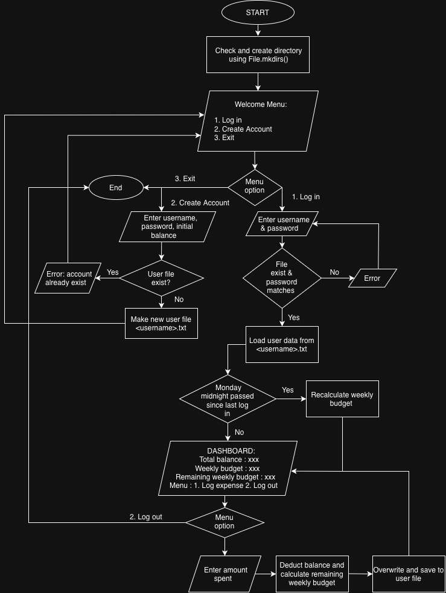

# Dining-Dollar-Tracker

Program to track and budget your weekly dining dollar spendings

## The problem
Budgeting your dining dollars so that you know how much you can spend without burning through it all mid-semester. This is a problem I want to solve because I find myself mindlessly spending and having to manually calculate if I'm on track in spending my dining dollars.

## How It Works

- Program keeps track of the user's dining dollar balance
- The program calculates the weekly budget by dividing balance with weeks left in the semester, recalculating weekly based on current balance
- User logs expenses every time they use dining dollars



## Tech Stack

- **Language:** Java
- **Data Storage:** Local test file storage ('.txt) stored under './data/users/'
- **Libraries:** `java.util.Date`, `java.io.File`, `java.io.PrintWriter`, `java.util.Scanner`

## Setup

Clone the repository and compile the source code:

```bash
git clone [https://github.com/kaylawjy/Dining-Dollar-Tracker.git](https://github.com/kaylawjy/Dining-Dollar-Tracker.git)
cd Dining-Dollar-Tracker
javac -d bin src/*.java
```

## Usage

Run the compiled application from the project root:

```bash
java -cp bin Main
```

## Roadmap

- Make graphical front end in java using Java Swing 
- Allow users to set certain weeks where they want to allocate more or less dining dollars
- User preference setting to show warning when more than a certain amount of the weekly budget has been spent too early in the week

## Author

Kayla Wijaya, https://github.com/kaylawjy 
